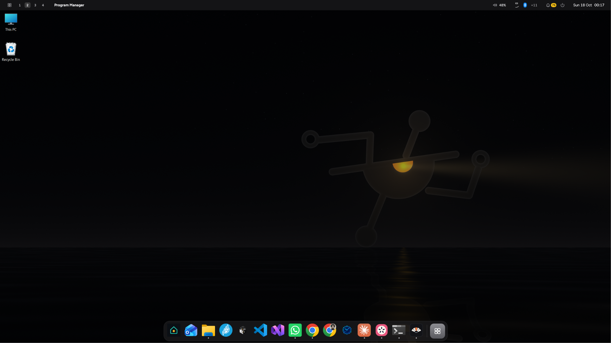
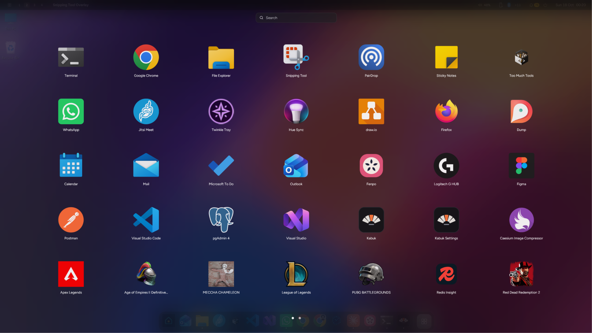
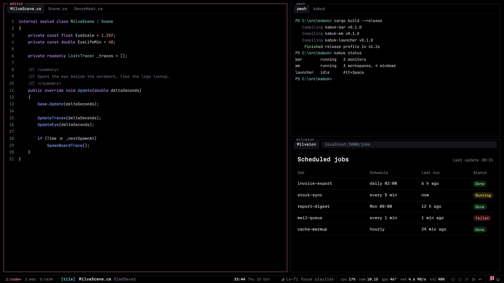
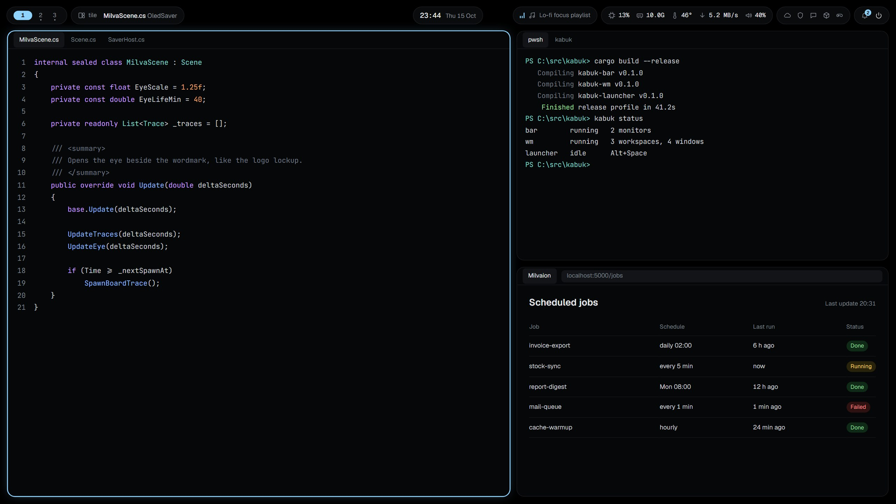
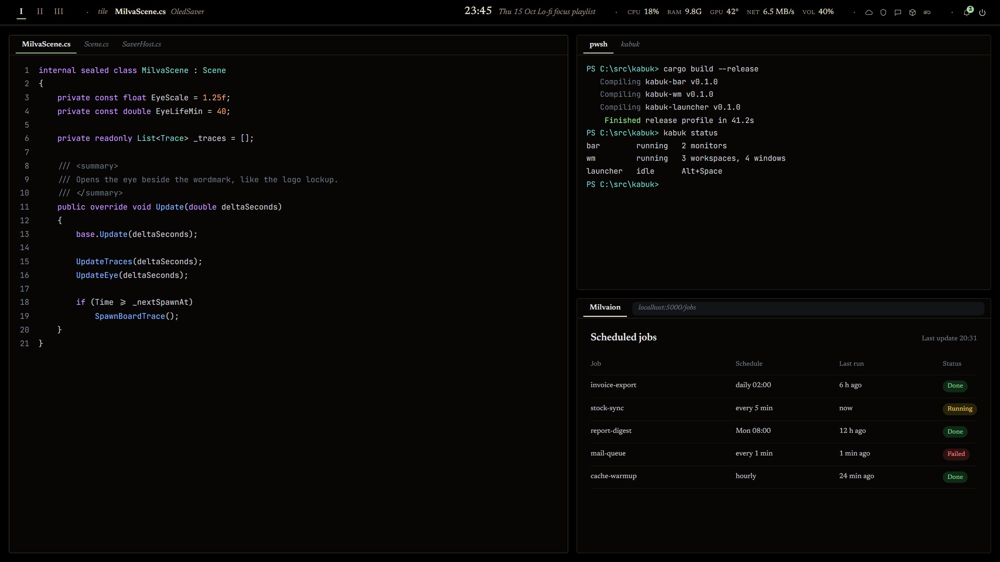

# Kabuk

Kabuk is a desktop shell for Windows 11, written in Rust. It hides the taskbar and puts its own bar on every monitor. It tiles your windows or lets them float, and comes with a launcher, notifications, animated wallpapers, a screen saver and a settings app.

It's for people who like how Hyprland, i3 and waybar feel but stay on Windows for games, Office or work tools. Everything comes in one package, with a settings screen and no pile of config files to set up first.



Kabuk is at version 1.0.9 and runs on my machine every day. It speaks Turkish and English.

Get it from the [Microsoft Store](https://apps.microsoft.com/detail/9NGK4T6XHF34) or the [latest release](https://github.com/Milvasoft/kabuk/releases/latest).

## If something goes wrong

You should know how to get out before you install. Kabuk hides windows (that's how workspaces work), hides the taskbar and changes the work area. It writes each of those changes to a state file before it makes them, so it can always undo them:

- `Ctrl+Alt+Shift+End` puts everything back and stops Kabuk. This one can't be rebound.
- `kabuk --restore` from any terminal does the same.
- If the shell crashes or someone kills it in Task Manager, a separate watchdog process restores everything by itself within two seconds and starts Kabuk again. If the bar or the window manager stops answering for 15 seconds, the watchdog ends it and does the same. After three restarts in a minute it gives up and tells you.

"Everything" means every hidden window, the taskbar and the work area. It also covers whatever Kabuk changed to match its look: cursors, the screen saver, the wallpaper, Windows' accent colours and other programs' window frames.

## What it does to Windows, and what it doesn't

Explorer stays. Kabuk hides the taskbar window and takes over the tray icons, but Explorer keeps running untouched underneath. When Kabuk exits, your taskbar comes back as it was. When Explorer restarts, the bar takes its space back and the tray icons register again.

Kabuk doesn't load code into other processes. It only uses its own keyboard and mouse hooks, which run inside Kabuk, plus Windows' documented APIs. The one undocumented call left is the `Progman` message that animated wallpapers need to draw behind the desktop icons. If a Windows update breaks it, you get the still version of the wallpaper.

Games are left alone. When a full-screen program covers a monitor, that monitor's bar goes away and tiling pauses. Kabuk also turns its keyboard and mouse hooks off, lowers its own priority, lets go of its GPU device and holds its notices until you're done. Nothing of Kabuk's touches the game's process.

When nothing changes, Kabuk doesn't draw. The clock wakes once a minute. Kabuk collects nothing and only goes online when you ask it to (see [PRIVACY.md](PRIVACY.md)).

## What you see

Each monitor gets a bar. It shows your workspaces, pinned and open apps (with jump lists on right click), the tray, the clock and date, volume, network, battery, keyboard language, media, and some live numbers: CPU, RAM, GPU temperature and network speed. You can turn off any of these. Clicking the network, the volume or the clock opens Kabuk's own panels instead of Windows' flyouts.

Windows tile as they open. The default layout is dwindle (each new window splits the space). Master-and-stack is one key away, and any workspace can also be all floating. Drag a window by its title and it floats. Hold Alt and you can move a window with the left button or resize it with the right, grabbing it anywhere. Dialogs, splash screens and windows that can't be resized float by themselves, so they don't break the layout. Programs running as administrator float too, since Kabuk can't move them.

A workspace covers all your monitors: Win+2 switches every screen to workspace 2.



| Key | Does |
| --- | --- |
| `Win+R` | Launcher: apps, open windows, files, bookmarks, a calculator |
| `Win+1…9` / `Win+Shift+1…9` | Go to a workspace / send the window there |
| `Win+arrows` / `Win+Shift+arrows` | Move focus / move the window |
| `Win+F` | Float or tile the window |
| `Win+Y` | Switch between dwindle and master |
| `Win+Tab` | Overview of every workspace |
| `Win+Enter` | Drop-down terminal |
| `Win+Shift+A` | Every app on a full-screen grid |
| `Win+F1` | The card with these keys |

Windows' own Win+L, Win+E, Win+V, Win+Shift+S and Win+Space keep working. You can change any of the other keys in Settings › Shortcuts.

## Ten looks

A look changes more than colours. Konsol is a tmux status line at the bottom with an fzf-style launcher coming up from below. Ray is a solid rail on the left. Defter is set in a serif with Roman numerals for workspaces. Rıhtım has a dock. The others are Ada, Çizgi, Devre, Etkinlik, Pano and Izgara. Each comes in dark and light, and you can change the accent colour. Every text, in every look, mode and accent, is held to a 4.5:1 contrast ratio. If you pick an accent that wouldn't be readable, Kabuk adjusts its shade instead of using it as is.

<p>
  
  
  
</p>

<sub>Konsol, Ada, Defter. These three are drawn renders from the website: the bars are the looks' own, the windows under them are staged.</sub>

The defaults are dark and OLED-minded: black bar, no seconds on the clock, the bar shifting a pixel or two now and then, idle dimming. The animated wallpapers and screen savers are mostly black and pause while the desktop is covered, during a game or on battery.

The settings app has a page for everything above, and every change applies at once. `%APPDATA%\kabuk\kabuk.toml` is still where the settings live, and if you edit it by hand Kabuk picks that up too. An invalid edit gets a notice with the line and column, and the last good configuration stays in use. [config/kabuk.example.toml](config/kabuk.example.toml) lists the keys.

## Installing

Kabuk needs Windows 11. You can get it in three ways:

- Download `kabuk-setup.exe` from the [latest release](https://github.com/Milvasoft/kabuk/releases/latest) and run it. It doesn't need administrator rights. It installs into `%LOCALAPPDATA%\Programs\Kabuk`, adds Kabuk and Kabuk Settings to the Start menu, puts `kabuk` on your `Path`, asks whether to start at sign-in, and starts it. `/S` installs without asking. Settings › About › "Check for updates" tells you when there's a new release, and its setup installs over the running copy.
- Get it from the [Microsoft Store](https://apps.microsoft.com/detail/9NGK4T6XHF34), which handles updates. The Store version can't set cursors, the screen saver or Windows' colours, because Store packages aren't allowed to write those settings ([D89](docs/DECISIONS.md)). Everything else is the same.
- Or start at the website, [kabuk.milvasoft.com](https://kabuk.milvasoft.com).

To uninstall, use Windows' "Installed apps" or run `kabuk --uninstall`. Windows goes back to how it was. Your settings stay in `%APPDATA%\kabuk` in case you come back.

From a terminal, `kabuk msg <command>` drives the running shell (`kabuk msg workspace 3`, `kabuk msg query windows` for JSON). `kabuk --help` lists all the commands.

## Building

You need Windows 11, [Rust](https://rustup.rs) (`x86_64-pc-windows-msvc`), Visual Studio Build Tools (the C++ workload and the Windows SDK) and the WebView2 Runtime, which comes with Windows 11. Node.js is only needed for the design tools and the settings page test.

```powershell
cargo build --release --workspace
```

`target\release` ends up with `kabuk.exe` (the shell), `kabuk-watchdog.exe`, `kabuk-settings.exe` and `kabuk-saver.exe` (the screen saver and the animated wallpapers). To install your build the way the setup would, run `.\kabuk.exe --install` from that folder. `tools/package.ps1` builds the setup itself.

Before you send a change, run the checks:

```powershell
powershell -ExecutionPolicy Bypass -File tools/check.ps1
```

This runs fmt, clippy with warnings as errors, the unit tests, and the Windows integration tests. The integration tests run the real shell on your desktop for a few seconds at a time, so expect test windows and bars to come and go while they run. [docs/TESTING.md](docs/TESTING.md) has the rules.

## More

- [docs/CONTRIBUTING.md](docs/CONTRIBUTING.md): the rules, starting with the ones that keep a user's desktop safe
- [docs/SPEC.md](docs/SPEC.md): what Kabuk does, in detail
- [docs/ARCHITECTURE.md](docs/ARCHITECTURE.md): how it's built
- [docs/PLAN.md](docs/PLAN.md): milestones, what was measured and what's still open
- [docs/DECISIONS.md](docs/DECISIONS.md): why things are the way they are

Apache License 2.0, see [LICENSE](LICENSE). Made by Milvasoft.
